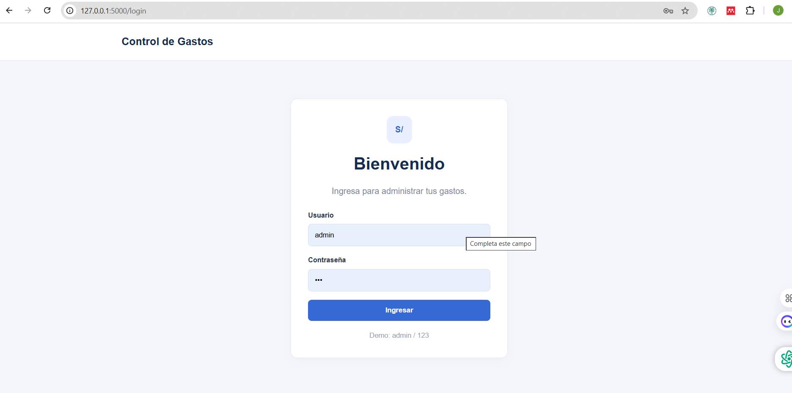
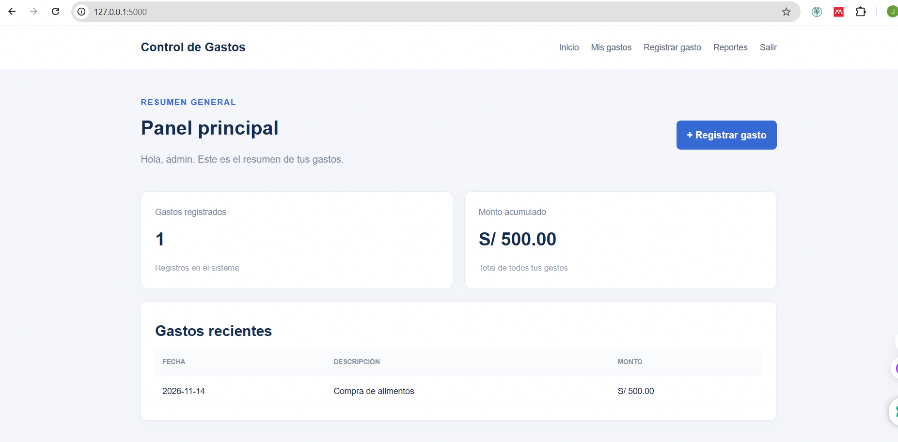
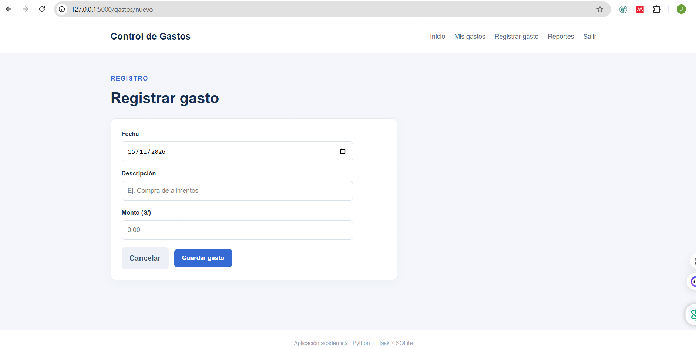
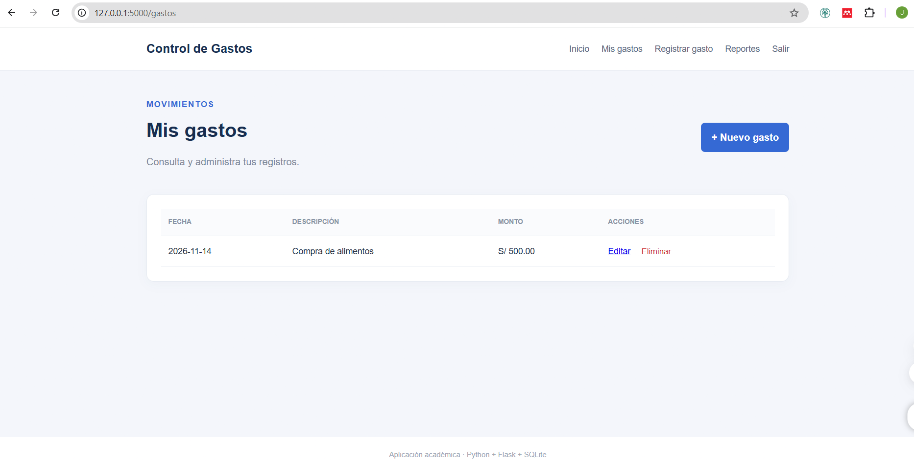
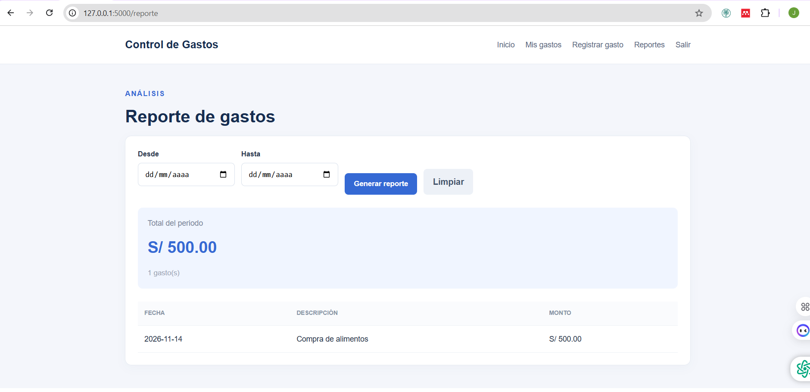

# Control de Gastos Personales

Aplicación web académica desarrollada con Python, Flask, SQLite, HTML, CSS y Jinja2.

## Credenciales de demostración
- Usuario: `admin`
- Contraseña: `123`

La contraseña se guarda como hash en SQLite. Las credenciales son solo para la práctica; en producción deben cambiarse y debe configurarse una clave secreta segura.

## Funcionalidades
- Inicio y cierre de sesión.
- Registro de gastos: fecha, descripción y monto.
- Listado, edición y eliminación de gastos.
- Reportes filtrados por fecha inicial y final.
- Cálculo del total del periodo.
- Persistencia con SQLite y validación de datos.

## Estructura
```text
control-gastos-flask/
├── app.py
├── requirements.txt
├── README.md
├── .gitignore
├── static/estilos.css
├── templates/
│   ├── base.html
│   ├── login.html
│   ├── index.html
│   ├── gastos.html
│   ├── form.html
│   ├── reporte.html
│   └── 404.html
└── screenshots/
```

## Instalación
```bash
git clone https://github.com/TU-USUARIO/control-gastos-flask.git
cd control-gastos-flask
py -m venv venv
venv\Scripts\activate
pip install -r requirements.txt
python app.py
```
Abrir http://127.0.0.1:5000/login. La base de datos y el usuario de demostración se crean automáticamente.

## Funcionamiento
1. Iniciar sesión con `admin` / `123`.
2. En el panel se observa la cantidad de gastos y el monto acumulado.
3. Elegir **Registrar gasto** e ingresar fecha, descripción y monto.
4. En **Mis gastos** se pueden listar, editar y eliminar registros.
5. En **Reportes** seleccionar fecha inicial y final para consultar el detalle y el total.
6. Cerrar sesión para salir.

## Capturas de pantalla
Ejecuta la aplicación, toma capturas reales y guárdalas en `screenshots/` con estos nombres:

### Inicio de sesión


### Panel principal


### Registro de gasto


### Listado de gastos


### Reporte


## Base de datos
SQLite utiliza las tablas `usuarios` (credenciales con hash) y `gastos` (fecha, descripción y monto). El archivo `gastos.db` se crea localmente y está excluido de Git para no publicar datos personales.

Trabajo académico - Programación y Desarrollo Web.
